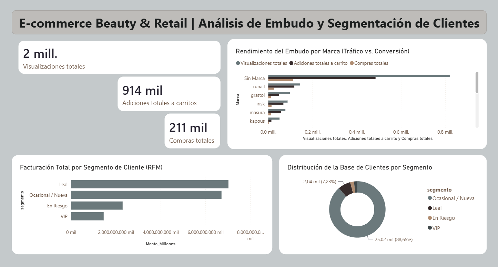

# Beauty & Retail Customer Intelligence & E-commerce Analytics

Proyecto de análisis de datos y Business Intelligence enfocado en el comportamiento de consumidoras dentro del sector de e-commerce de belleza y cosmética, procesando un dataset de más de 4 millones de registros para optimizar la toma de decisiones comerciales y operativas.

## 

## Tabla de Contenidos

1. [Descripción del Proyecto](#descripción-del-proyecto)
2. [Stack Tecnológico y Herramientas](#stack-tecnológico-y-herramientas)
3. [Proceso de Ingeniería y Limpieza de Datos](#proceso-de-ingeniería-y-limpieza-de-datos)
4. [Arquitectura y Análisis del Dashboard en Power BI](#arquitectura-y-análisis-del-dashboard-en-power-bi)
5. [Estrategia de Segmentación RFM y Acciones de Negocio](#estrategia-de-segmentación-rfm-y-acciones-de-negocio)
6. [Estructura del Repositorio](#estructura-del-repositorio)

---

## 1. Descripción del Proyecto

El objetivo principal de este proyecto es transformar datos transaccionales masivos en inteligencia de negocio accionable. Se evaluó el rendimiento comercial de un e-commerce de cosmética mediante la auditoría del embudo de conversión (_funnel_) por marca y la segmentación de la cartera de clientas utilizando el modelo **RFM** (Recencia, Frecuencia y Monto Total). El proyecto cubre todo el ciclo de vida del dato: desde la extracción y limpieza en Python hasta la visualización ejecutiva en Power BI.

## 2. Stack Tecnológico y Herramientas

- **Lenguaje:** Python 3.x
- **Librerías de Datos:** Pandas, NumPy, Matplotlib, Seaborn
- **Business Intelligence:** Power BI Desktop (Modelado de datos, medidas DAX personalizadas y diseño de dashboards ejecutivos)
- **Control de Versiones y Entorno:** Git, GitHub, VS Code, Entorno Virtual (venv)

## 3. Proceso de Ingeniería y Limpieza de Datos

El dataset original contenía más de 4,2 millones de registros de interacciones de usuarias. Durante la fase de preprocesamiento en Python se implementaron los siguientes criterios:

- **Manejo de Valores Nulos:** Se identificó que la columna `category_code` presentaba un porcentaje elevado de nulos y `brand` un 41,6%. Para evitar sesgos por pérdida masiva de información, se imputaron los valores faltantes de marca bajo la categoría "Sin Marca" y se estructuró el análisis a nivel de identificadores de producto.
- **Depuración de Anomalías:** Se filtraron precios negativos o iguales a cero para garantizar la integridad financiera en el cálculo de montos totales.
- **Estandarización Temporal:** Conversión de marcas temporales de texto a formato datetime para permitir el cálculo preciso de recencia en el modelo RFM.

## 4. Arquitectura y Análisis del Dashboard en Power BI

El informe se estructuró en una única página de alta densidad ejecutiva para facilitar la lectura gerencial. A continuación se detallan los componentes visuales principales, su justificación, hallazgos y soluciones propuestas:

### A. Tarjetas de KPI Globales (Volumen del Embudo)

- **Por qué se incluye:** Permiten medir de un vistazo el volumen total de interacciones en la parte superior y final del embudo (tráfico bruto de visualizaciones frente a transacciones concretadas).
- **Insight Extraído:** Se evidencia una caída natural y masiva en el recorrido de compra (de más de 2 millones de vistas a aproximadamente 211 mil compras efectivas), reflejando la fricción estándar de abandono en la pasarela de pagos o en la decisión de compra.
- **Solución Propuesta:** Implementar campañas de retargeting automatizado y optimización de la velocidad de carga de la pasarela de pago para reducir la tasa de carritos abandonados.

### B. Gráfico de Barras Agrupadas: Rendimiento del Embudo por Marca

- **Por qué se incluye:** Evalúa de forma comparativa el comportamiento del tráfico y la conversión (`view`, `cart`, `purchase`) desglosado por marca de cosmética.
- **Insight Extraído:**
  - Se identificó a **`runail`** como el benchmark de eficiencia del catálogo, registrando una tasa de conversión superior al 18% desde la visualización hasta la compra.
  - Se detectó una fricción crítica en marcas como **`jessnail`**, cuya tasa de conversión se desploma por debajo del 5% a pesar de recibir un flujo constante de visitas.
- **Solución Propuesta:** Replicar las buenas prácticas de `runail` (optimización de recursos visuales, descripciones técnicas y competitividad de precios) en el resto del catálogo, y realizar una auditoría comercial urgente sobre `jessnail` para evaluar problemas de stock o barreras de precio.

### C. Gráfico de Barras Horizontales: Facturación por Segmento RFM (`Monto_Millones`)

- **Por qué se incluye:** Cuantifica el impacto económico real de cada segmento de clientas para identificar dónde se concentra la facturación de la compañía.
- **Insight Extraído:** Los segmentos **Leal** y **Ocasional / Nueva** concentran el mayor volumen monetario global de la empresa, demostrando una alta dependencia de compras recurrentes estándar y del flujo continuo de adquisición de nuevos usuarios.
- **Solución Propuesta:** Proteger el flujo de ingresos de las clientas leales mediante políticas de recompensa por frecuencia, y optimizar el costo de adquisición (CAC) en el segmento ocasional mediante estrategias de venta cruzada (_cross-selling_).

### D. Gráfico de Anillo: Distribución de la Base de Usuarias por Segmento

- **Por qué se incluye:** Analiza la composición demográfica y comportamental de la base de compradoras para medir la salud de la cartera.
- **Insight Extraído:** La gran mayoría de la base está compuesta por clientas ocasionales o nuevas, pero se aísla un núcleo reducido y estratégico de 611 clientas clasificadas como **En Riesgo** y 551 como **VIP**.
- **Solución Propuesta:** Diseñar campañas focalizadas de reactivación para el segmento "En Riesgo" antes de que abandonen definitivamente la plataforma, y otorgar estatus de exclusividad al segmento "VIP".

## 5. Estrategia de Segmentación RFM y Acciones de Negocio

A partir de la segmentación de la base, se establecieron directrices operativas para el equipo de marketing:

- **Clientas Leales y VIP:** Se priorizan programas de fidelización, acceso anticipado a lanzamientos y beneficios exclusivos, evitando descuentos agresivos que erosionen el margen de ganancia.
- **Clientas En Riesgo:** Usuarias con alta frecuencia histórica que acumulan más de 15 días sin transaccionar. Se pauta una campaña automatizada de remarketing con incentivos personalizados para rescatar la relación comercial.
- **Ocasionales / Nuevas:** El segmento más voluminoso, sobre el cual se aplican estrategias de recomendación de productos complementarios para elevar el ticket promedio de compra.

## 6. Estructura del Repositorio

```text
beauty-retail-analytics/
├── data/
│   ├── raw/                 # Archivos CSV originales de Kaggle (excluidos del control de versiones)
│   └── processed/           # Tablas limpias y procesadas (funnel_por_marca.csv, segmentacion_rfm.csv)
├── notebooks/               # Cuadernos Jupyter con el EDA y la lógica de transformación
├── dashboard/               # Archivo fuente de Power BI (.pbix)
├── .gitignore               # Configuración de exclusión para entornos y archivos pesados
└── README.md                # Documentación técnica del proyecto
```
